# Life v2 — System design

**Status:** proposed, 2026-10-07. **Audience:** developers and agents building v2.

Requirements are in [REQUIREMENTS_V2](../requirements/REQUIREMENTS_V2.md) and the product view is in the [PRD](../product/PRD.md). Diagram sources live in [`diagrams/src/diagrams.py`](./diagrams/src/diagrams.py). Regenerate them with `python docs/architecture/diagrams/src/diagrams.py`; this needs Python 3 and a local Chrome or Edge, and no network.

---

## 1. Rebuild strategy

**Decision: keep the foundation, replace the domain model and the UI.** Work happens on branch `v2`. Nothing is reverted, and the old screens stay in git history.

| | What | Why |
|-|------|-----|
| **Keep** | npm-workspace monorepo; Next.js App Router; Fastify; Drizzle + Postgres (Supabase); Zod in `@life/shared`; Serwist PWA; Vitest + ESLint setup | Works, is tested, and fits v2. A rewrite would cost weeks for no user value. |
| **Keep, generalise** | Sync engine (`apps/web/src/lib/sync/sync-engine.ts`) becomes an entity-agnostic outbox. `local-db.ts` persists to IndexedDB instead of localStorage. | The same pull/push idea, without the habit-only tables and the 5 MB cap |
| **Keep the maths** | `computeMonthlyPrayerReport`, `isFriday` (`packages/shared/src/prayer.ts`, `quran.ts`); `summarizeCounter` / `summarizeExercise` / `summarizeSleep` (`health-tracking.ts`); `ProgressRing`, `WeeklyBars` logic | Re-pointed at occurrences; existing tests are kept as regression cases |
| **Replace** | `habit_definitions` / `habit_logs` schema → §4 schema plus a migration script; `globals.css` themes and fonts; `today-dashboard.tsx`, `prayer-tracker.tsx`, `health/*` cards, bottom nav, route structure | The owner rejected the UI; the data model can't express tasks, plans, moves, or sub-items |
| **Fix on the way** | BUG-002 (sync ownership check); B-001 (`drizzle-kit migrate` on Windows) | Needed before multi-user |

Why not start from scratch: auth, sync, offline storage, PWA build quirks (Webpack for Serwist, the sql.js WASM postinstall), the DB connection setup, and the test infrastructure were all solved and documented in DECISION.md. Starting over would re-learn them.

Why not keep going on the current code: the Home, prayer, and health screens are habit-specific, and the owner wants them gone. The one-log-per-day table cannot hold one-off tasks, moved instances, plan steps, or sub-items.

---

## 2. Context and architecture

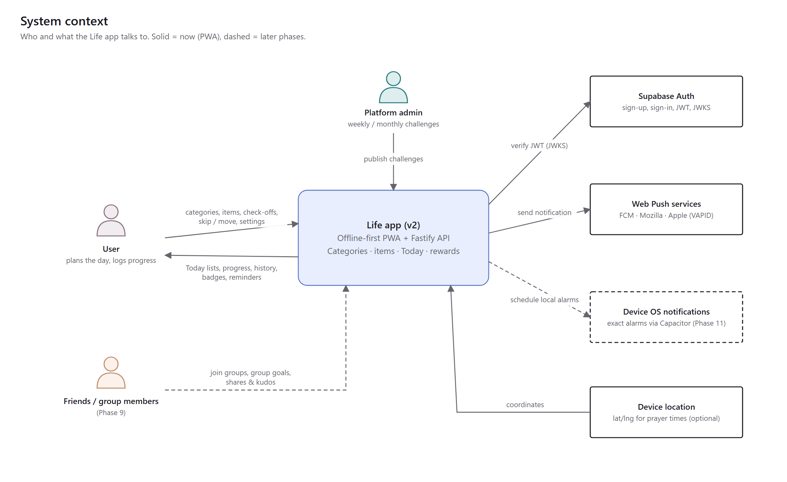

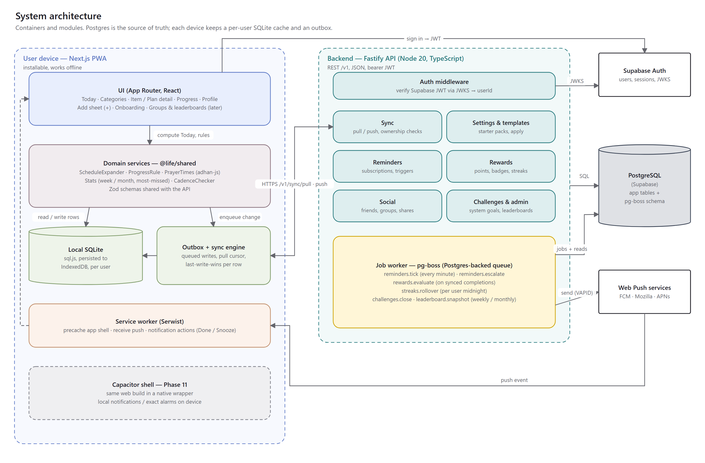

| Container | Tech | Responsibilities |
|-----------|------|------------------|
| **PWA (device)** | Next.js 16 App Router, React 19, Tailwind 4, Serwist | UI. Domain services from `@life/shared`. Local SQLite (sql.js → IndexedDB, one DB per user). Outbox. Service worker for offline shell, push, and notification actions. |
| **API** | Fastify on Node 20, Drizzle, Zod | Verifies the Supabase JWT (JWKS, cached) to get `userId`. Runs sync with ownership checks, settings and templates, reminders, rewards read APIs, social, and challenges. |
| **Jobs** | In-process timers over queue tables in the same Postgres (`reminder_queue`, `FOR UPDATE SKIP LOCKED`); pg-boss only if later jobs need it | `reminders.tick` every minute, `reminders.escalate`, `rewards.evaluate`, `streaks.rollover` at each user's midnight, `challenges.close`, `leaderboard.snapshot` |
| **Data** | Postgres (Supabase) | Source of truth for all tables (§4) |
| **Auth** | Supabase Auth | Email and password, password reset, optional Google sign-in. The API never stores passwords. |
| **Push** | Web Push (VAPID) via the `web-push` npm package | Chrome / Android / desktop; iOS 16.4+ **only when installed to the Home Screen**. Not available in EU standalone PWAs since iOS 17.4. |
| **Later** | Capacitor shell (Phase 11) | Same web build; local notifications and **exact alarms**; share sheet |

Choices made here (logged in DECISION.md):

- **Supabase Auth** over self-hosted auth. Postgres is already on Supabase. JWT verification via JWKS keeps Fastify stateless. Accounts map 1:1 to `users.id`.
- **Postgres queue tables** over Redis/BullMQ (and, for reminders, over pg-boss: DECISION 2026-10-12). There is no new infrastructure, jobs are transactional with app data, and the volume is small.
- **Server-computed rewards.** Clients sync facts (occurrences). Points, badges, streaks, and ranks are derived on the server, so a modified client cannot grant itself points (NFR-04).

---

## 3. Data flow

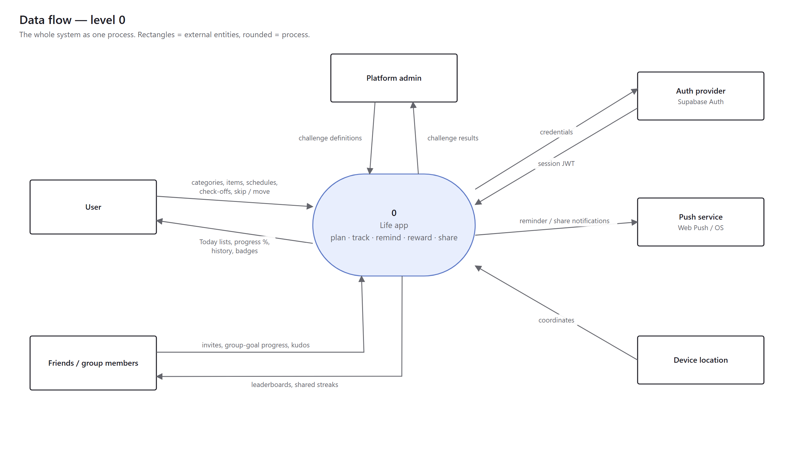

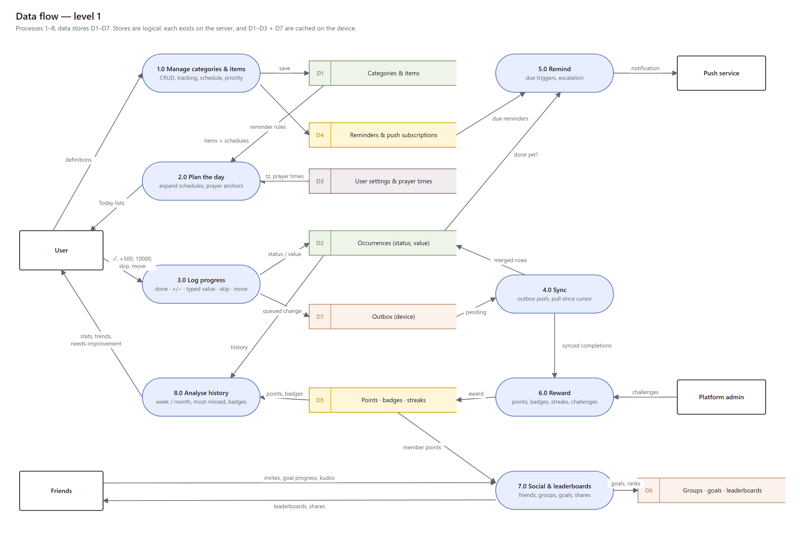

---

## 4. Data model

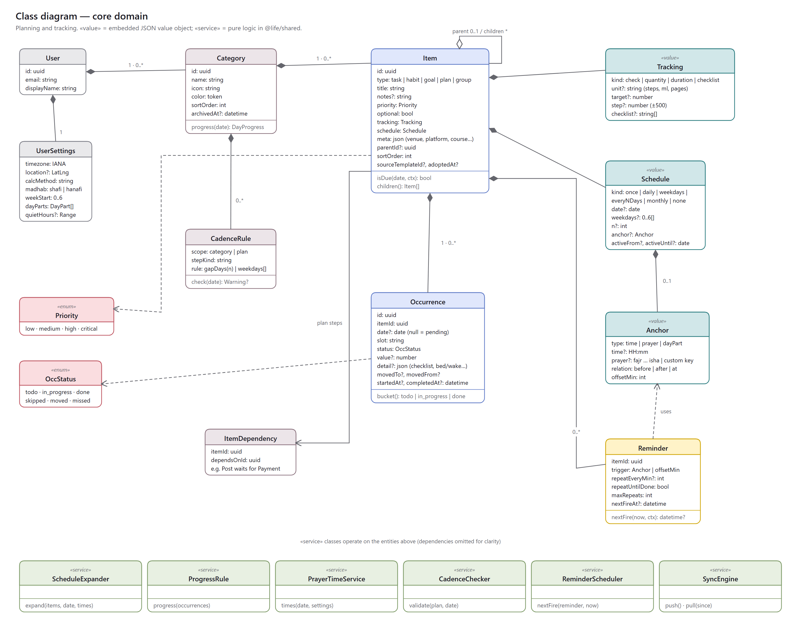

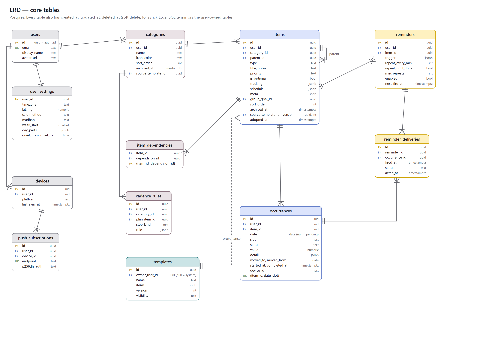

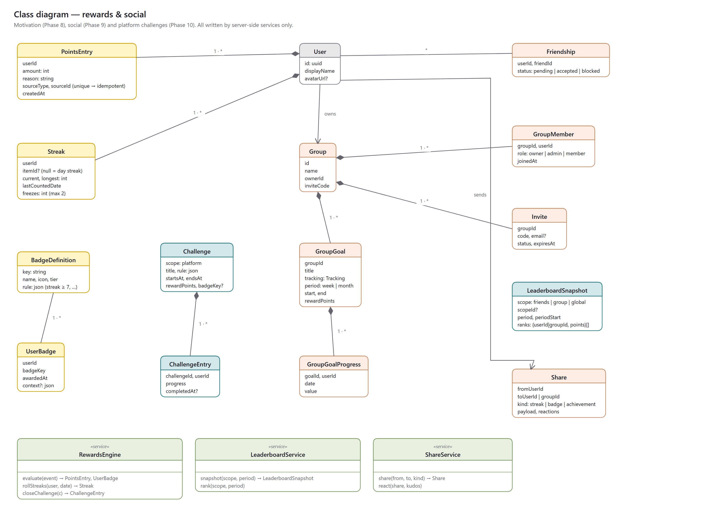

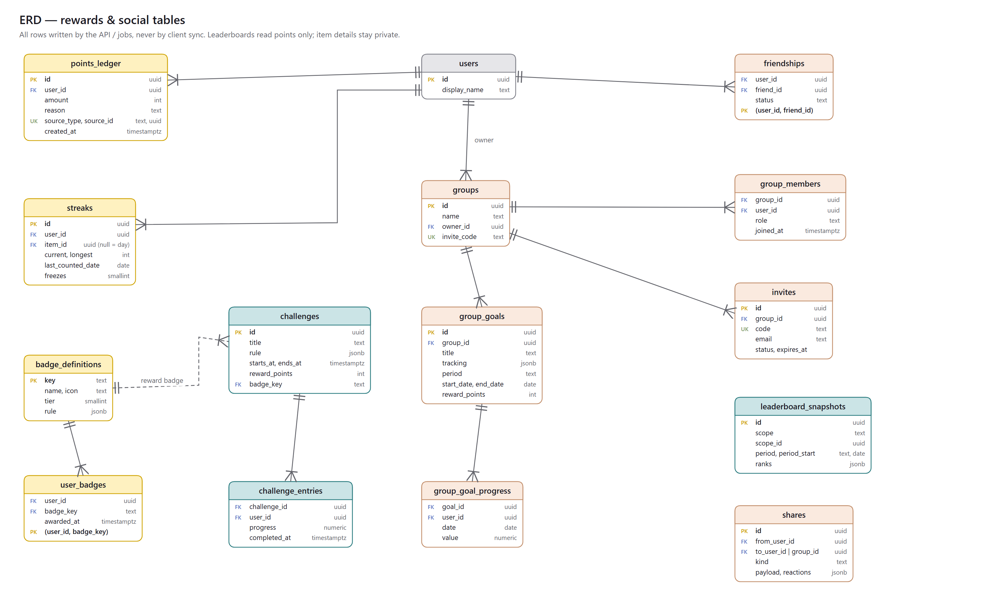

### 4.1 Rules

- Every user-owned table has `user_id`, `created_at`, `updated_at`, and `deleted_at` (soft delete, so deletions sync).
- **Client-syncable entities:** `categories`, `items`, `item_dependencies`, `cadence_rules`, `occurrences`, `reminders`, `user_settings`.
- **Server-only entities:** everything in rewards and social, `reminder_deliveries`, `push_subscriptions` (registered through an endpoint), and `templates`.
- `items.tracking`, `items.schedule`, and `reminders.trigger` are JSONB validated by shared Zod schemas. They are versioned with a `v` field so the shapes can evolve.
- `occurrences` are unique on `(item_id, date, slot)`. `slot` defaults to `""`; it lets an item occur twice a day if ever needed. A pending task has `date = NULL`.

### 4.2 JSON shapes (Zod, in `@life/shared`)

```ts
Tracking  = { v:1, kind:'check' }
          | { v:1, kind:'quantity', unit:string, target?:number, step:number }   // step 500 → ±500
          | { v:1, kind:'duration', targetMin?:number }
          | { v:1, kind:'checklist', steps:string[] }

Schedule  = { v:1, kind:'once', date:string|null, time?:string }                 // date null = pending
          | { v:1, kind:'daily'|'weekdays'|'everyNDays'|'monthly',
              weekdays?:number[], n?:number, monthDay?:number,
              anchor?:Anchor, activeFrom?:string, activeUntil?:string }

Anchor    = { type:'time', time:'HH:mm' }
          | { type:'prayer', prayer:'fajr'|'sunrise'|'dhuhr'|'asr'|'maghrib'|'isha'|string,
              relation:'before'|'at'|'after', offsetMin:number }
          | { type:'dayPart', key:string }

Trigger   = { type:'at', time:'HH:mm' } | { type:'beforeDue', min:number } | Anchor
```

---

## 5. Core behaviour

### 5.1 Building Today

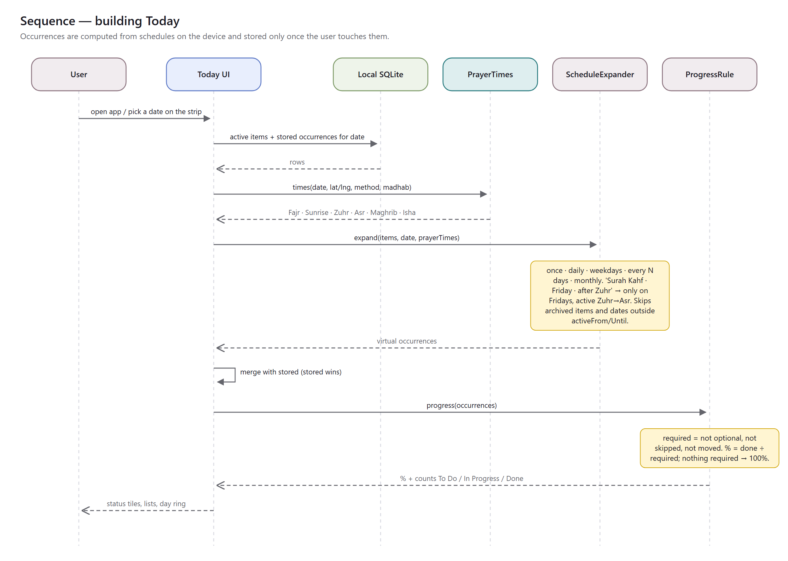

1. Load active items and the stored occurrences for the date from local SQLite.
2. Compute prayer times for the date (adhan-js) from `user_settings`. If no location is set, use manual times.
3. `ScheduleExpander.expand(items, date, times)` yields **virtual occurrences** for items due that day.
   - Virtual occurrences are stored only when touched (ticked, valued, skipped, or moved). This keeps the table small and makes schedule edits apply retroactively to untouched days.
4. Merge: a stored occurrence wins over its virtual twin. Stored occurrences whose item is no longer due (moved-in, one-offs) are added.
5. Sort into **To Do / In Progress / Done**:
   - **Done:** `done`
   - **In Progress:** `in_progress`, or a quantity with `0 < value < target`
   - **To Do:** everything else that is not skipped or moved
   - Skipped and moved occurrences show in a collapsed "Not today" row.
6. `ProgressRule`:
   - `required` = occurrences where `!optional && status ∉ {skipped, moved}`, excluding pending items
   - `pct = done / required`
   - `required = 0` → 100%

**Anchor windows:**

- "after Zuhr" is active from Zuhr until the next prayer time; "before Zuhr" from the previous prayer until Zuhr; "at" ±30 min.
- The window drives ordering and the "now" highlight, and reminders when set.
- A user can still tick an item outside its window; windows guide, they never lock.

### 5.2 Flexible day operations

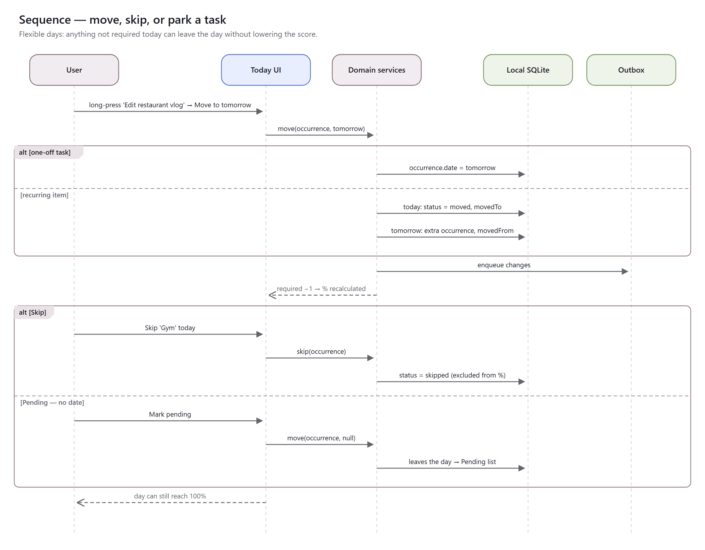

| Action | One-off task | Repeating item |
|--------|--------------|----------------|
| Skip | `status = skipped` | Same, for that date only |
| Move to date D | `date = D` (item `schedule.date` and its stored occurrence) | Today: `status = moved, moved_to = D`; plus a new occurrence on D with `moved_from`, in slot `moved:<from>` so it can't collide with D's own instance |
| Pending | `date = NULL` | Not offered (use Skip) |
| Missed | Never set by the user for tasks. At day rollover, unresolved required occurrences count as missed in stats only. | Same. Prayers can also be marked Missed explicitly. |

### 5.3 Prayer

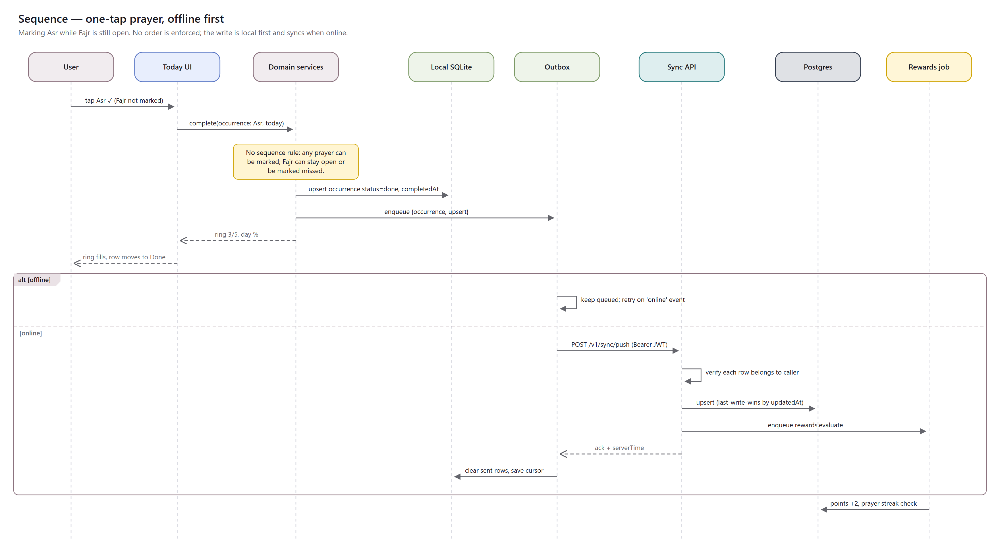

- "Daily prayers" is an item of type `group`. Its children are prayer items with `meta.prayerKey`. Users rename, add, remove, and reorder children (PRY-01) and move the group (PRY-02).
- One tap sets the child's occurrence to `done`. Long-press opens Missed, Qada (done late, flagged), and Undo. Order is never enforced (PRY-04).
- The ring on the group shows the children's statuses.
- `PrayerInsights` computes week and month totals, rate per prayer, most missed, and most consistent. It extends `computeMonthlyPrayerReport`.

### 5.4 Plans and cadence

- A plan is an item of type `plan`. Its steps are child items, normally one-off tasks with dates.
- `item_dependencies` rows lock a step until the step it depends on is done. Locked steps show a lock and the reason.
- **Presets** are templates applied in one tap; they're data, not code:
  - Content collab: Shoot → Edit → Payment cleared → Post; Post depends on Payment
  - University: Assignment, Quiz, Presentation, Teacher meeting, FYP task / meeting
- `CadenceChecker` is a pure function. When a step date is picked, it checks the `cadence_rules` of the plan and its category (`gapDays`, allowed `weekdays`). It returns warnings and the next valid dates and never blocks.

### 5.5 Reminders

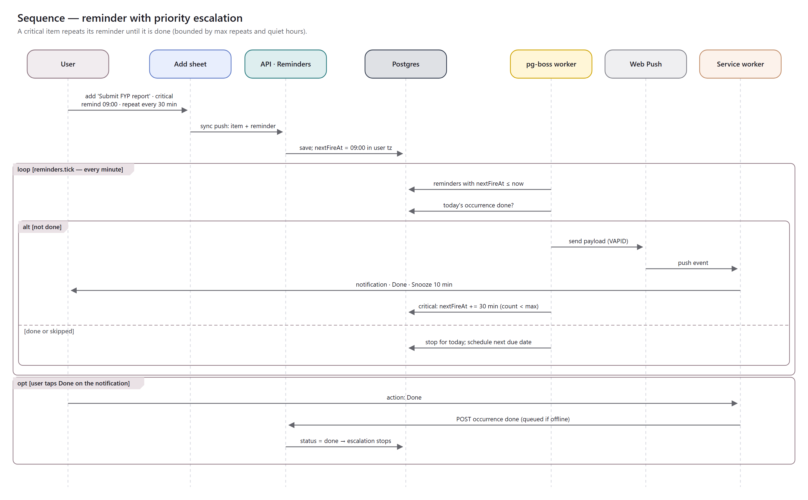

**Next fire time.** `ReminderScheduler.nextFire(reminder, now, ctx)` is shared code; the API uses it to store `next_fire_at`. Prayer-relative triggers use the same adhan-js code on the server, with the user's location.

**`reminders.tick` (every minute):**

1. Select due reminders with `FOR UPDATE SKIP LOCKED`.
2. Skip any whose occurrence is done or skipped.
3. Respect quiet hours.
4. Send the push to every subscription of the user.
5. Write `reminder_deliveries`.
6. Set the next `next_fire_at`:
   - repeat (critical), while the delivery count is below `max_repeats`
   - otherwise the next due date

**Priority defaults (REM-02):**

| Priority | Default reminders |
|----------|-------------------|
| low | none |
| medium | 1 |
| high | 1, plus a follow-up after 30 min |
| critical | every 30 min until done, max 6 |

**Notification actions.** In the service worker, **Done** posts the occurrence, or queues it when offline. **Snooze** sets the next fire to now + 10 min.

**Limits stated to the user:**

- iOS needs the app installed to the Home Screen.
- Delivery isn't exact to the second.
- Alarms come with the native wrap.

### 5.6 Sync

- **Outbox:** each local write appends `{entity, id, op, row, updatedAt}`.
- **Push:** `POST /v1/sync/push` with a batch. The server:
  1. validates each row with Zod
  2. checks ownership: `row.user_id = caller`, and that every referenced category, item, or parent belongs to the caller (BUG-002)
  3. upserts last-write-wins by `updated_at`
  4. enqueues `rewards.evaluate` for occurrences that changed to `done`
- **Pull:** `GET /v1/sync/pull?since=cursor` returns changed rows of all syncable entities, including soft deletes, plus `serverTime`.
- **Quantities sync as absolute values,** not deltas. Two devices editing the same day's steps resolve last-write-wins; this is accepted for v2.

### 5.7 Rewards, social, challenges

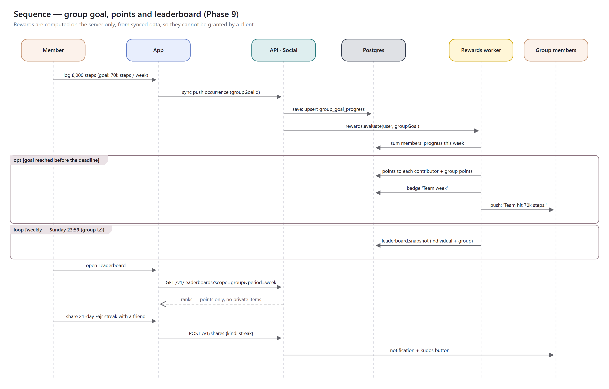

**Points ledger.** Each row has a unique `(source_type, source_id)`, so re-evaluation never double-counts.

| Event | Points |
|-------|--------|
| Completion, low / medium / high / critical | 1 / 2 / 3 / 5 |
| Perfect day | +10 |
| Badge | per definition |
| Challenge | per challenge |
| Group goal | per goal, to each contributor |

Completions logged more than 48 h after their date earn 0 points (HIS-04).

**Streaks:**

- per item, and per day (day % = 100)
- `streaks.rollover` runs at each user's local midnight
- freezes: earn 1 per 7-day streak, hold at most 2; a freeze is consumed automatically
- a reset shows "Start a new streak"

**Badges.** Rules are JSON evaluated by `RewardsEngine.checkBadges`, e.g. `{metric:'streak', item:'prayer-group', gte:7}`.

**Leaderboards:**

- weekly and monthly snapshots per scope (friends, group, global opt-in)
- group vs group uses **average points per active member**, which is fairer to small groups
- only points and display names are exposed (SOC-05)

**Shares:**

- a `shares` row plus a push to the recipient
- kudos are stored as `reactions` on the share

---

## 6. API surface (v1)

All routes require `Authorization: Bearer <Supabase JWT>`, except `/health*`.

| Method and path | Purpose | Phase |
|---------------|---------|-------|
| `GET /health`, `GET /health/db` | Liveness, DB readiness (existing) | — |
| `GET /v1/me` · `PUT /v1/settings` | Profile, settings (settings also sync) | 1 |
| `GET /v1/sync/pull?since=` · `POST /v1/sync/push` | Offline sync of all user-owned entities | 1 |
| `GET /v1/templates` · `POST /v1/templates/:id/apply` | Starter packs and presets (creates categories and items with provenance) | 3 |
| `POST /v1/push/subscriptions` · `DELETE /v1/push/subscriptions/:id` | Web Push registration | 6 |
| `POST /v1/reminders/:id/snooze` | Snooze from a notification | 6 |
| `GET /v1/stats/items/:id?period=` · `GET /v1/stats/overview?period=` | Server copy of history stats (the device computes locally too) | 7 |
| `GET /v1/rewards` | Points total, level, badges, streaks | 8 |
| `GET/POST /v1/friends` · `POST /v1/friends/:id/accept` · `DELETE /v1/friends/:id` | Friends | 9 |
| `POST /v1/groups` · `GET /v1/groups/:id` · `POST /v1/groups/:id/invites` · `POST /v1/invites/:code/accept` | Groups and invites | 9 |
| `POST /v1/groups/:id/goals` · `GET /v1/groups/:id/goals` | Group goals | 9 |
| `GET /v1/leaderboards?scope=&period=` | Ranks | 9 |
| `POST /v1/shares` · `GET /v1/shares/inbox` · `POST /v1/shares/:id/react` | Sharing and kudos | 9 |
| `GET /v1/challenges` · `POST /v1/challenges/:id/join` | Platform challenges | 10 |
| `POST/PUT /v1/admin/challenges` | Admin (role claim `admin`) | 10 |

Errors keep the existing shape: `{ error: { code, message } }`.

---

## 7. Front-end structure

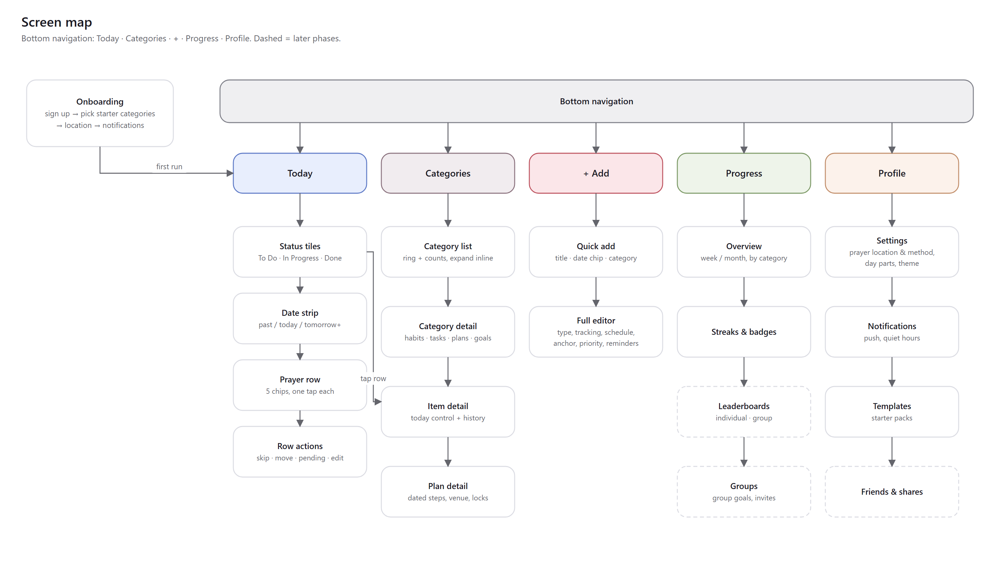

```
apps/web/src/app/
  (auth)/sign-in, sign-up, reset
  (main)/layout.tsx              bottom nav: Today · Categories · + · Progress · Profile
  (main)/page.tsx                Today
  (main)/categories/page.tsx     list + inline expand
  (main)/categories/[id]/        category detail
  (main)/items/[id]/             item detail + history (prayer group gets its own insight panel)
  (main)/plans/[id]/             plan detail (steps, locks, cadence warnings)
  (main)/progress/               overview, streaks & badges, (later) leaderboards, groups
  (main)/profile/                settings, notifications, templates, (later) friends
  onboarding/
components/ui/                   rebuilt kit from DESIGN_SYSTEM_V2 (Card, StatusTile, Ring, Bars, Stepper, Chip, Sheet…)
lib/domain/                      thin hooks over @life/shared services
lib/db/, lib/sync/               generalised local store + outbox
```

---

## 8. Security and privacy

- Identity comes only from the verified JWT. Request bodies never carry `userId`.
- Every query is filtered by `user_id`. Sync push verifies ownership of every referenced id; tests cover cross-user attempts.
- Server-only tables are never accepted from sync.
- Social reads expose display name, avatar, and points only. Item titles are never exposed unless shared.
- Local DB per user; signing out wipes it (ACC-03).
- Rate limiting is on auth-adjacent and social endpoints (`@fastify/rate-limit`).
- The admin role comes from a Supabase custom claim and is checked server-side.

## 9. Testing

| Layer | What | Where |
|-------|------|-------|
| Pure domain | `ScheduleExpander` (incl. anchors, DST, Fridays), `ProgressRule`, `CadenceChecker`, `ReminderScheduler`, `PrayerInsights`, `RewardsEngine` rules | `packages/shared` (Vitest) |
| API | Ownership rejection, LWW, soft delete, idempotent ledger, leaderboard maths | `apps/api` (Vitest + test DB) |
| Migration | Fixture old logs → new rows, round-trip counts | `apps/api/scripts` test |
| UI | Today buckets, one-tap prayer, stepper typed and ± input, move / skip | `apps/web` (RTL) |
| E2E | Golden flows at 430 px, light and dark | Browser check per phase (`browser-automation`) |

## 10. Risks

| Risk | Mitigation |
|------|------------|
| iOS push only when installed; none in EU standalone | Install prompt, an in-app reminder list as fallback, and the Capacitor phase |
| Prayer-time accuracy differs by method | Method and madhab in settings; manual override per prayer |
| Virtual occurrences confuse history when a schedule changes | History reads stored occurrences plus schedule versions. Missed days are computed with the schedule as of that date (`items.schedule` changes are logged in `meta.scheduleHistory`). |
| Leaderboard cheating via backfill | 48 h points window; server-only computation |
| Scope creep (social before the core is solid) | Releases are gated. R3 starts only after R1–R2 acceptance. |
