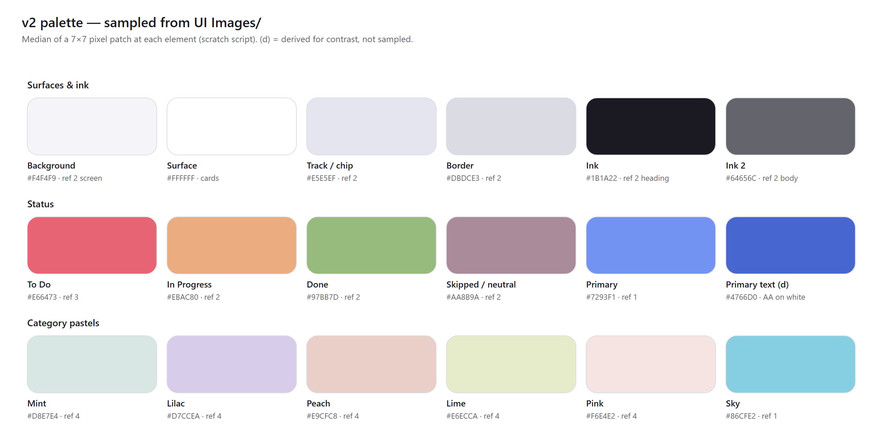

# Design system v2: simple, from the owner's references

**Status:** proposed, 2026-10-07. It replaces the 2026-09-30 visual direction (Space Grotesk, award-site palettes, tiles) per conflict C1 in [REQUIREMENTS_V2](../requirements/REQUIREMENTS_V2.md).

**Source of truth:** the four images in `UI Images/` at the repo root. Every color below was **sampled** from those images: a scratch script took the median of a 7×7 pixel patch at each UI element. Values marked **(d)** are **derived**, either because no reference covers them (dark mode) or because a sampled value failed WCAG AA for text.

## 1. What the references have in common

| Ref | What it shows | What we take |
|-----|---------------|--------------|
| 1 — finance app (3 screens) | Lavender-grey canvas `#E6EAF6`; near-white screens; white cards; one blue accent `#7293F1`; thin donut and slim vertical bars; small pastel icon tiles | Canvas and cards, primary blue, bar and ring style, icon tiles |
| 2 — task manager (Today / Projects / Report) | "Today" heading with a date; **2×2 colored status tiles** (Ongoing / In Process / Complete / Cancel); pill segmented tabs (All / Ongoing / Completed); list rows with checkbox and progress line; project cards with a ring %; bottom bar with a **center +** | Status tiles, segment tabs, list rows, ring-in-card, center + nav, muted status palette |
| 3 — "My Tasks" | **To Do / In Progress / Done** rows with round colored icons and counts; bold geometric sans (**Poppins**); rounded project cards with a ring % | Exact Home structure, typeface, round status icons |
| 4 — pastel habit tracker | Soft mint, lilac, peach, lime, and pink tiles and rows; lots of white space; thin type | Category pastel set, calm density |

**The rules that follow:** one canvas color, white cards, color only where it carries meaning (status, category), one typeface, thin rings and bars, generous spacing, and a single obvious action per row.

## 2. Tokens

### Light (sampled)

| Token | Value | Source | Use |
|-------|-------|--------|-----|
| `--bg` | `#F4F4F9` | ref 2 screen | App background |
| `--surface` | `#FFFFFF` | refs 1–3 cards | Cards, sheets, nav |
| `--track` | `#E5E5EF` | ref 2 canvas | Ring and bar tracks, chips, segmented-control background |
| `--border` | `#DBDCE3` | ref 2 | Hairlines, input borders |
| `--ink` | `#1B1A22` | ref 2 heading | Primary text |
| `--ink-2` | `#64656C` | ref 2 body | Secondary text (5.29 : 1 on `--bg`) |
| `--status-todo` | `#E66473` | ref 3 "To Do" | To Do tile and icon |
| `--status-progress` | `#EBAC80` | ref 2 "In Process" | In Progress |
| `--status-done` | `#97BB7D` | ref 2 "Complete" | Done |
| `--status-muted` | `#AA8B9A` | ref 2 "Ongoing" / FAB | Skipped, moved, neutral |
| `--primary` | `#7293F1` | ref 1 card and button | Rings, bars, selected states, fills with ink text |
| `--primary-strong` (d) | `#4766D0` | derived from `--primary` | Filled buttons with white text (5.15 : 1), links |
| `--cat-mint` · `--cat-lilac` · `--cat-peach` · `--cat-lime` · `--cat-pink` | `#D8E7E4` · `#D7CCEA` · `#E9CFC8` · `#E6ECCA` · `#F6E4E2` | ref 4 | Category chips and expanded-category backgrounds |
| `--cat-sky` · `--cat-teal` · `--cat-yellow` | `#86CFE2` · `#2E9499` · `#FDC703` | ref 1 / ref 3 | Category icons and accents |

**Text on status colors is always `--ink`, never white.** Contrast is 5.29 : 1 on To Do, 8.83 on In Progress, and 7.98 on Done. White text on those colors fails AA.

### Dark (derived — owner to review in Phase 0)

| Token | Value | Basis |
|-------|-------|-------|
| `--bg` | `#1B1A22` | Sampled ink, reused as canvas |
| `--surface` (d) | `#25242E` | `--bg` lifted ~6% |
| `--track` (d) | `#2F2E3A` | |
| `--border` (d) | `#3A3946` | |
| `--ink` | `#F4F4F9` | Sampled light bg (15.7 : 1) |
| `--ink-2` (d) | `#A9AAB4` | 7.47 : 1 |
| Status, primary, category accents | Same as light | Dark ink text on fills, as in light |
| Category pastels (d) | Each pastel at 30% over `--surface` | Keeps hue, avoids glare |

### 2a. Themes — one per reference image (owner, 2026-10-09)

A theme changes the light-mode canvas, the primary fills, and link text. Status and category colors never change, so To Do and Done read the same in every theme. (d) = derived by changing lightness only, until WCAG AA passes. `lib/theme/tokens.test.ts` checks every theme × mode.

| Theme | Source | Light canvas | Primary | Strong (white text) | Link light / dark |
|-------|--------|--------------|---------|---------------------|-------------------|
| **Sky** (default) | ref 1 | `#F4F4F9` | `#7293F1` | `#4766D0` (d) | `#4766D0` / `#7293F1` |
| **Mauve** | ref 2 | `#F4F4F9` | `#AA8B9A` | `#906A7D` (d) | `#896476` (d) / `#AA8B9A` |
| **Sunset** | ref 3 | `#FFF9EB` (cream) | `#2E9499` (teal) | `#287F83` (d) | `#277D81` (d) / `#309CA1` (d) |
| **Lavender** | ref 4 | `#F0E6E7` | `#927AB3` (d, petal hue) | `#5D477C` (petal) | `#5D477C` / `#9A85B9` (d) |

- **Switching:** pick the theme in Profile or in the top-bar user menu.
- **Storage and application:** stored under `life_theme`; applied as `data-theme` before paint.
- **Mode:** Light / Dark / System is independent of the theme.

### 2b. Interaction and form rules (owner, 2026-10-09)

- **Pointer cursor** on everything clickable, set globally in `globals.css` because Tailwind v4 resets it. `not-allowed` on disabled controls.
- **Every form** is validated through `lib/forms/validators.ts` and `use-form.ts`:
  - Required fields show `*`.
  - Errors appear after a field is left, or after a submit attempt.
  - **The submit button is disabled until the form is valid**, with a one-line hint underneath explaining why.
- **Numeric fields accept digits only.** Other characters are stripped as the user types (`sanitizeDigits`). This covers the quantity stepper and the OTP code.
- **Passwords:** 8+ characters with uppercase, lowercase, a number and a symbol. A live checklist and strength bar show progress, and a show/hide toggle is always available.

## 3. Type

- **Poppins** via `next/font/google`, weights 400, 500, and 600. Space Grotesk and Space Mono are removed.
- No uppercase micro-labels above headings. This is the owner's standing rule since 2026-09-30.

| Style | Size / line | Weight | Use |
|-------|-------------|--------|-----|
| Title | 24 / 32 | 600 | Screen title ("Today") |
| Heading | 18 / 26 | 600 | Section ("To Do") |
| Body | 15 / 22 | 400 | Row titles |
| Body strong | 15 / 22 | 500 | Item names in detail |
| Caption | 13 / 18 | 400 | Meta: time, category, "after Zuhr" |
| Number | 28 / 32 | 600 | Ring %, stat values |

## 4. Shape, space, elevation

| Property | Values |
|----------|--------|
| Radius | Cards 20; tiles 20; inputs and buttons 14; chips and segmented controls 999 |
| Spacing | 4-pt base. Screen gutter 16. Card padding 16. Row height ≥ 56. Touch targets ≥ 44. |
| Shadow | One level only: `0 4px 16px rgb(27 26 34 / 6%)` on cards; none in dark mode, where the border is used instead |
| Rings | 6–8 px stroke with round caps on `--track`, % centred in Number style |
| Bars | 6 px wide, fully rounded, on `--track` |

## 5. Components

| Component | Spec | Reference |
|-----------|------|-----------|
| **StatusTile** | 3 across. Status-colored fill, ink count (Number) and label (Caption), round icon top-right. Tap filters. | ref 2 tiles, ref 3 icons |
| **TaskRow** | White card row: 28 px round check on the left (empty, half for in-progress, filled for done), title plus caption meta, priority dot (critical = `--status-todo`), chevron. Long-press opens a sheet with Skip / Move / Pending / Edit. | ref 2 list |
| **QuantityRow** | TaskRow plus value / target, thin progress line, a **− [value] +** stepper (tap the value to type) | ref 2 progress line |
| **PrayerRow** | One card: small ring on the left, then N chips (Fajr…Isha) that each toggle with one tap and show done, missed, or open by fill | ref 3 ring, ref 2 chips |
| **CategoryCard** | Pastel icon tile, name, "3 of 5 today", ring on the right. Expands inline to TaskRows. | ref 2 project card, ref 4 pastels |
| **SegmentedTabs** | Pill on `--track`; selected = white pill | ref 2 |
| **DateStrip** | 7 days in a row, selected = `--primary` pill with ink text, dot for days with items | ref 1 weekly bars row |
| **BottomNav** | White bar; 4 icons plus a center **+** (56 px, `--primary-strong` with a white icon) | ref 2 |
| **Sheet** | Bottom sheet for add, edit, and actions; 20 px top radius | — |
| **PrayerRow (v2)** | Chips carry the local time; the current prayer gets a 2 px primary ring; subtitle "Asr now · until 5:36 PM" / "Maghrib in 42 min"; hold or right-click a chip → On time / Qada / Missed / Clear; qada = progress fill, missed = red outline; footer for "approximate · Set location" | ref 3 ring, ref 2 chips |
| **Location sheet** | Our pre-prompt before the browser's: Always (disabled on web), While using (primary), Choose a city, Never (text button); city search over bundled cities | — |
| **Now highlight** | A row whose time window contains now gets a 2 px primary ring (`data-now`) | — |
| **Day view** | Sections per prayer-based day part, with a time range and a "Now" tag | ref 1 |
| **PlanCard** | Preset icon tile, title, venue / course caption, "Next: Edit · Wed 14 Oct" and overdue tags, 36 px progress ring | ref 2 project card |
| **StepRow** | Round tick, or a lock with "Waits for …"; kind icon and title; date and time inputs; a cadence warning box (soft progress fill) with suggested-date chips — never blocks | — |
| **Rules editor** | Per step kind: weekday chips and a "keep apart by" select; scope tabs This plan / All <category> plans | — |
| **Settle in place** | Rows don't jump while edited: they keep their section for 2.5 s after the last tap, show a primary "→ Done" tag, then move with a view transition | — |
| **ConfirmSheet** | Small "Delete …?" sheet: body text, Cancel and a red-filled confirm button | — |
| **GroupRow** (routine) | Card with a 28 px ring, title, "3/5" tag and category tag; expands to its sub-items as TaskRows; done when all sub-items are done | ref 2 project card |
| **Checklist row** | TaskRow with a "2/5 steps" tag and a "Show steps" toggle listing small tick rows | — |
| **Heatmap** | Month calendar, Monday first; done = `--done` fill, started = `--progress`, missed = faint `--todo`, skipped = dashed outline, today = ring; legend underneath | — |
| **IconPicker / ColorPicker** | 8-column grid of 36 px icon tiles; round swatches for the 8 category tones; selected = ink ring | ref 4 pastels |
| **Pill / PillGroup** | Compact 32 px single-choice pills (When, Kind, Repeat, Category) | ref 2 |

Icons stay **lucide-react** (already a dependency), 20 px with a 1.75 stroke.

## 5a. Density and breakpoints (owner, 2026-10-10)

- **Phone first.**
  - Controls are 36–44 px: buttons md 40 / lg 44 / sm 32, fields 40.
  - Row title is 14 px; tags are 20 px tall with 11 px text.
  - Section headings are 15 px. The day title is 20 px.
- **Column width:**
  - phone: full width with a 16 px gutter
  - `md`: 672 px
  - `lg`: a 224 px left rail (Add task plus the four destinations) replaces the bottom bar
- **Sheets:**
  - phone: bottom sheet
  - `sm` and up: centred dialog, max 448 px, with a fade-in
- **Popups:**
  - row menu: 208 px
  - account menu: 264 px with 36 px rows
- **Auth:** a 400 px column. Password rules appear once typing starts. Sign-up must fit 390×844 without scrolling.

## 6. Today layout (phone)

1. Header: "Today" (Title) and date (Caption) on the left; day ring (48 px) on the right.
2. DateStrip.
3. StatusTiles ×3.
4. PrayerRow, if placed on Today.
5. "Overdue" (today only): past one-off tasks not finished, each with "Was due …" and "Move to today".
6. "To Do" (Heading) with TaskRows sorted by time, then "In Progress", then "Done" (collapsed after 3 items). Rows carry tags: category, time, progress, priority, repeat.
7. "Not today" (skipped and moved), collapsed.
8. "Upcoming" (today only): the next 14 days, grouped by day; tapping a header jumps to that day.
9. BottomNav (side rail at `lg`). Adding a task shows a toast with its destination and a View action.

## 7. Don'ts (carried over and new)

- No side color bars on cards. No invented hex values. No eyebrow labels on every section.
- No more than one accent per card. Status color goes on the tile or icon, never on the whole row.
- No hidden gestures as the only way to act: long-press always has a visible "⋯" twin.
- No gradients or illustrations. Ref 4's florals are decoration we deliberately leave out, for "simple".

## 8. Phase 0 deliverable

- A static **UI kit page** (`/dev/ui-kit`, dev-only) showing every component above in light and dark at 430 px.
- The owner approves it before Phase 2 builds Today on it.
