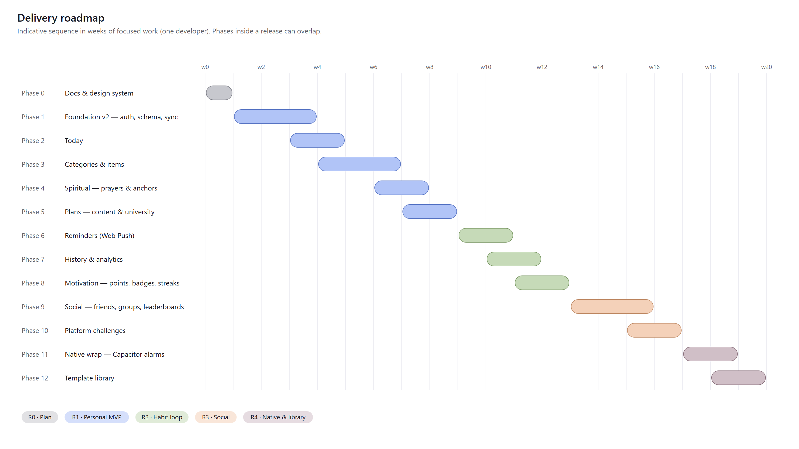

# Life v2 — Development plan

**Branch:** `v2`, cut from `master` on 2026-10-07. Phase specs: [`docs/phases/v2/`](../phases/v2/README.md).
Inputs: [REQUIREMENTS_V2](../requirements/REQUIREMENTS_V2.md) · [SYSTEM_DESIGN](../architecture/SYSTEM_DESIGN.md) · [PRD](../product/PRD.md) · [DESIGN_SYSTEM_V2](../design/DESIGN_SYSTEM_V2.md)

Durations are indicative (one developer, focused weeks). Phases inside a release can overlap where dependencies allow.

## Releases and gates

| Release | Phases | Gate to start the next release |
|---------|--------|--------------------------------|
| R0 Plan | 0 | Owner approves this pack and the UI kit |
| R1 Personal MVP | 1–5 | Owner uses R1 daily for one week. All MUSTs of phases 1–5 pass. Migrated history matches the old reports. |
| R2 Habit loop | 6–8 | Reminders verified on Android Chrome and an installed iPhone PWA. Points are idempotent under re-sync. |
| R3 Social | 9–10 | Two real accounts complete a group goal end to end. Privacy tests pass. |
| R4 Native and library | 11–12 | Store builds approved |

## Phases at a glance

| # | Phase | Main deliverables | Depends on |
|---|-------|-------------------|------------|
| 0 | [Docs and design system](../phases/v2/phase-00-docs-design.md) | This pack, tokens, Poppins, UI kit page | — |
| 1 | [Foundation v2](../phases/v2/phase-01-foundation.md) | Supabase Auth, new schema, migration, generalised sync, IndexedDB store, BUG-002 | 0 |
| 2 | [Today](../phases/v2/phase-02-today.md) | Status buckets, date strip, one-tap, skip / move / pending, progress rule, new shell and nav | 1 |
| 3 | [Categories and items](../phases/v2/phase-03-categories-items.md) | Category and item CRUD, tracking kinds, priority, schedules, routines, item detail | 2 |
| 4 | [Spiritual](../phases/v2/phase-04-spiritual.md) | Prayer group, adhan-js, anchors, day parts, insights | 3 |
| 5 | [Plans](../phases/v2/phase-05-plans.md) | Plan steps, dependencies, presets, cadence | 3 |
| 6 | [Reminders](../phases/v2/phase-06-reminders.md) | Web Push, pg-boss, escalation, quiet hours | 3 (4 for prayer triggers) |
| 7 | [History and analytics](../phases/v2/phase-07-history.md) | Progress page, summaries, backfill, missed rollover | 3 |
| 8 | [Motivation](../phases/v2/phase-08-motivation.md) | Points ledger, streaks and freezes, badges | 7 |
| 9 | [Social](../phases/v2/phase-09-social.md) | Friends, groups, group goals, leaderboards, shares | 8 |
| 10 | [Platform challenges](../phases/v2/phase-10-challenges.md) | Challenges, admin | 8 |
| 11 | [Native wrap](../phases/v2/phase-11-native.md) | Capacitor, alarms, share image | 6 |
| 12 | [Template library](../phases/v2/phase-12-template-library.md) | LIB-01…05 | 3 |

## Working rules (unchanged from AGENT.md, restated for v2)

1. One phase at a time. Each phase ends with every MUST passing, `npm run test`, `lint`, and `typecheck` green, and a browser check at 430 px in light and dark.
2. Decisions go in `DECISION.md`, bugs in `PROJECT.md`, status in `PROGRESS.md`.
3. Domain logic lives in `packages/shared` as pure, tested functions. UI components stay thin.
4. Every new sync entity gets an ownership test in `apps/api`.
5. No UI ships without being built from the Phase 0 kit components.

## What happens to the old code

| Old | When it goes |
|-----|--------------|
| `habit_definitions`, `habit_logs` tables | Read-only after the Phase 1 migration; dropped at the start of R2 |
| `today-dashboard.tsx`, `prayer-tracker.tsx`, `health/*`, `goals/content` page, old `globals.css` themes, `ThemePicker` | Deleted in Phase 2, when the new shell replaces them |
| `computeMonthlyPrayerReport`, `summarize*`, `ProgressRing`, `WeeklyBars` | Kept and adapted in Phases 3, 4, and 7 |
| `ensureDefaultUser`, `SYNC_API_KEY` | Removed in Phase 1 |
| `docs/phases/phase-06…14` | Moved to `docs/phases/archive/` (superseded) |
